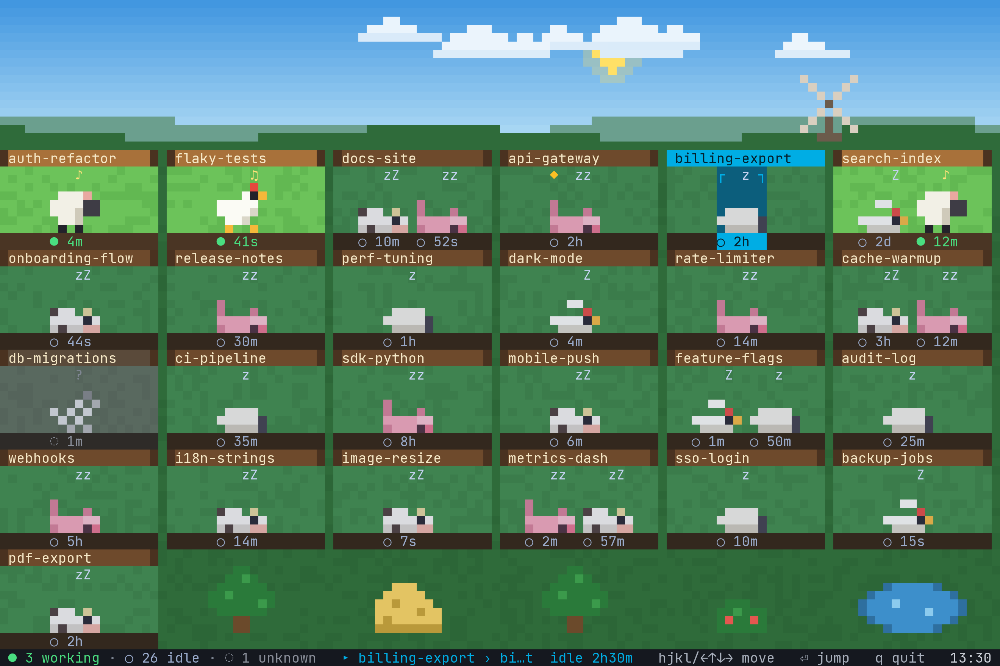

# terminal-farm

A live terminal farm of your [herdr](https://herdr.dev) agent panes. Every herdr workspace is a plot with a wooden sign; every agent in it is an animal. Standing with ♪ = working, lying down with z's = idle, grey ghost with ? = blocked or unknown. The sky follows your local clock.



## Run

```sh
node terminal-farm.js          # live, 8 fps; hjkl/arrows select, Enter jumps to the pane, q quits
node terminal-farm.js --once   # print one frame and exit
node terminal-farm.js --256    # force 256-colour output (auto when $COLORTERM isn't truecolor)
node terminal-farm.js --no-caffeinate   # don't keep the Mac awake
```

## Caffeinated by default

While the live screen runs, terminal-farm keeps your Mac awake with `caffeinate -dims -w <terminal-farm's pid>`: no display sleep, idle sleep, disk sleep, or system sleep on AC power. `-w` makes caffeinate exit when terminal-farm does, including on a crash, so nothing is left running. A ☕ in the status bar and the terminal title show it is on. `--once` never caffeinates. Opt out with `--no-caffeinate`.

## Sky

The sky follows your local clock. Clouds drift and the windmill turns all the time, day and night; the windmill spins faster while any agent is working.

`alias tfarm='node ~/misc/terminal-farm/terminal-farm.js'`

## Real durations

herdr reports state but not since when. `extension/terminal-farm-status.ts` is a pi extension that writes `~/.terminal-farm/state/<pid>.json` (`status`, `since`) on session start, agent start and agent settled, and deletes it on shutdown. Install it once:

```sh
ln -s ~/misc/terminal-farm/extension/terminal-farm-status.ts ~/.pi/agent/extensions/
```

Only pi sessions started after that carry it. For older sessions terminal-farm shows `?` until it sees their state change itself.

## How it works

- `terminal-farm.js` polls `herdr workspace list` + `herdr agent list` every second, maps each pane to its pi pid with `herdr pane process-info` (cached 10s), and reads that pid's state file.
- `vendor/engine.js` is the design's reference renderer (layout, sprites, sky, animation, ANSI). Changes from the design: `fmtDur` returns `?` for an unknown duration, and the windmill turns slowly even when every agent is idle.
- Only changed rows are rewritten each frame.
- Design hand-off notes: `docs/design-assets.md`.

Self-check for the extension: `JITI=<path to jiti> node test/extension.check.js`.
